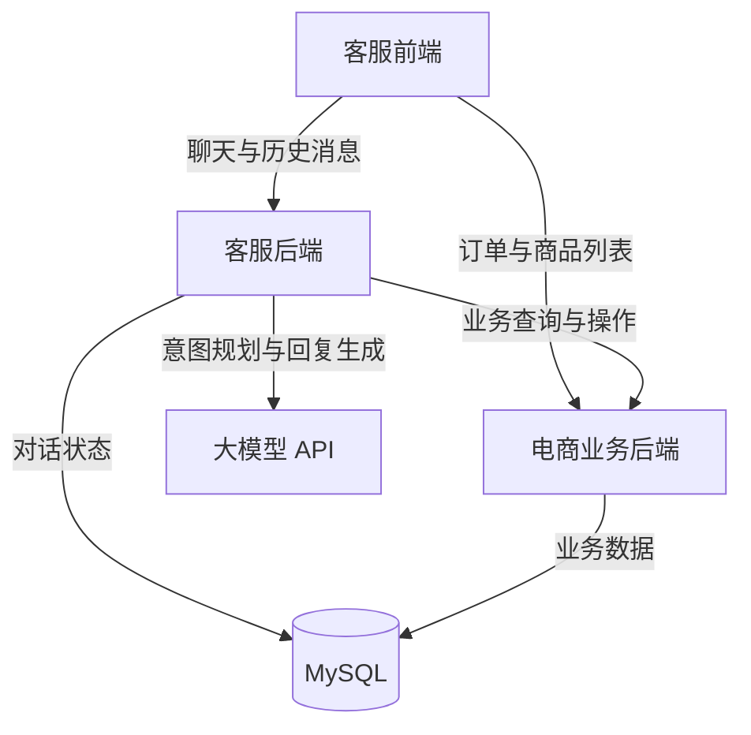

# 电商小二：项目概述与整体架构总结

> 来源：《01【电商小二】项目概述与整体架构.md》。本文总结课程设计，不代表当前仓库已实现这些能力。

## 1. 项目要解决什么问题

构建电商智能客服，处理订单、物流、退款、商品和政策咨询，减少人工重复劳动。

核心思路是：**LLM 理解用户意图，程序执行明确的业务动作，状态和流程由工程代码管理。** 通过规划校验、固定流程和可信数据来源，控制模型输出的不确定性。

## 2. 三条对话轨道

每轮根据用户意图选择一条轨道。

| 轨道 | 适用场景 | 处理方式 |
| --- | --- | --- |
| Task：任务流程 | 查订单状态、查物流、申请退款 | 按 YAML 定义的步骤收集信息、执行动作 |
| Knowledge：信息检索 | 商品咨询、政策咨询、平台规则 | 从业务 API、FAQ 或知识库获取信息，再组织回答 |
| Chitchat：闲聊 | 打招呼、寒暄、模糊输入 | 生成自然回复，提供兜底体验 |

信息检索的数据来源按问题选择：商品和订单等实时信息来自业务 API；退款、退货、配送政策适合 FAQ；平台规则和通用知识适合 RAG（检索增强生成）。

任务与咨询可能涉及同一业务对象，区别在于用户是要推进明确任务，还是了解相关信息。

## 3. YAML 如何描述任务流程

以退款为例：

```text
开始 → 收集订单号 → 收集退款原因 → 执行动作 → 结束
```

| 配置字段或类型 | 含义 |
| --- | --- |
| `id` | 步骤标识 |
| `type` | 步骤类型：`start`、`collect`、`action`、`end` |
| `next` | 下一个步骤 |
| `slot_name` | 要收集的信息名称，例如 `order_number` |
| `response` | 收集信息时的提示语 |
| `action` / `args` | 动作名称及其参数 |

“槽位（slot）”就是流程需要保存的信息，例如订单号、退款原因。回复模板可通过 `{{ slots.order_number }}` 引用这些值。

**YAML 只定义流程，不会自行执行。** PyYAML 将配置读取为数据，流程引擎解释步骤，动作代码执行具体业务。已有步骤和动作能力支持的流程可以通过修改配置扩展；新增业务动作仍需要代码实现。

原文退款 YAML 使用 `action_response` 生成“已提交”回复，不能仅凭这段配置判断它已调用真实退款接口。实际创建退款申请需要接入相应业务动作。

## 4. 系统由哪些组件组成



| 组件 | 职责 |
| --- | --- |
| `customer-service-frontend` | 聊天界面、历史记录、订单与商品对象展示 |
| `customer-service-backend` | 课程开发核心：状态管理、意图规划、轨道调度、模型和业务调用 |
| `ecommerce-service-backend` | 模拟业务中台，提供订单、物流、商品、催发货、退款申请等接口 |
| MySQL | 保存对话状态和电商业务数据 |

## 5. 客服后端如何分层

| 层 | 主要职责 |
| --- | --- |
| API | 接收 HTTP 请求、返回响应 |
| Service | 串联一次完整对话处理，加载与保存状态 |
| Engine | 对话引擎，组织规划并调度处理轨道 |
| Planning | 本轮意图判断、规划、校验与澄清 |
| Task / Knowledge / Chitchat | 分别执行任务、检索回答、闲聊兜底 |
| Domain | 定义消息、上下文、对话状态等模型 |
| Repository | 持久化 `DialogueState` |
| Infrastructure | 封装 LLM、HTTP、数据库等外部访问 |
| Config | 加载环境变量与配置 |

一条消息的主要处理顺序：

1. API 接收消息，`DialogueService` 加载 `DialogueState`。
2. 准备当前会话和本轮对话（turn）。
3. 文本消息由 `TurnPlanner` 规划；意图不明确时先反问澄清，明确后进入对应轨道。
4. 对象消息解析订单、商品等上下文，触发澄清并尝试补槽，再交给任务处理器。
5. 处理完成后提交本轮结果，保存对话状态并返回回复。

状态保存让系统能够跨多轮记住已收集的信息，继续未完成的任务。

## 6. 技术栈与基础设施要点

| 技术 | 用途 |
| --- | --- |
| Python 3.12 / uv | 后端运行环境、依赖管理 |
| FastAPI | HTTP 服务 |
| LangChain / langchain-openai | 模型调用封装 |
| Pydantic / pydantic-settings | 数据结构、配置加载与校验 |
| PyYAML / Jinja2 | YAML 流程加载、Prompt 等模板渲染 |
| HTTPX | 异步调用电商服务 |
| SQLAlchemy / aiomysql 或 asyncmy | 异步访问 MySQL |

基础设施重点：

- **配置**：通过 `BaseSettings` 读取 `.env` 和环境变量，用 `lru_cache` 复用配置实例。
- **模型**：统一配置模型名、API 地址和密钥；示例设置 `temperature=0`，降低生成随机性，但不保证结果绝对确定。
- **HTTP**：复用 `httpx.AsyncClient`，设置超时，应用结束时关闭客户端。
- **数据库**：使用异步引擎、连接池和会话工厂；`pool_pre_ping=True` 检查连接可用性，结束时释放引擎。
- **提交后属性访问**：异步会话通常设置 `expire_on_commit=False`，避免属性过期后普通访问触发隐式数据库 I/O；需要最新数据时可显式查询或 `await session.refresh(obj)`。这不表示异步场景完全不能使用属性过期机制。
- **事务**：会话使用后可能自动开启事务；未提交就关闭时出现 `ROLLBACK`，不一定意味着执行失败。只读查询通常无需为消除日志而额外提交，写操作则应明确管理提交和回滚。

## 7. 环境准备与学习顺序

原文提供的环境准备顺序：

1. 初始化 MySQL，执行 `001_init_customer_service.sql` 和 `002_init_commerce.sql`。
2. 配置电商后端 `.env`，执行 `uv sync`、`uv run python main.py`。
3. 前端执行 `npm install`、`npm run dev`，默认访问 `http://127.0.0.1:5173`。
4. 创建客服后端，准备 `flow_config`、`.env` 和 `pyproject.toml`，执行 `uv sync`，逐步实现基础设施和对话能力。

建议学习顺序：**理解三条轨道 → 理解 YAML 与槽位 → 跑通配置和外部连接 → 理解单轮消息链路 → 实现多轮状态与业务处理。**

原文未给出完整客服后端的启动入口；以上是课程环境说明，执行前需确认对应目录、依赖和配置已具备。
